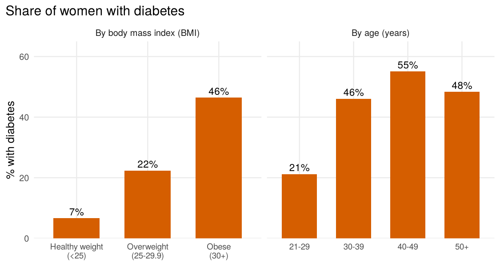
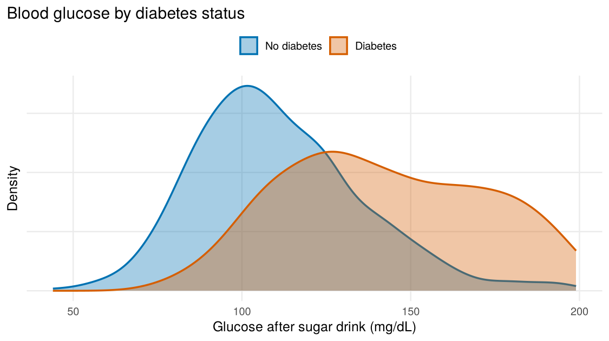
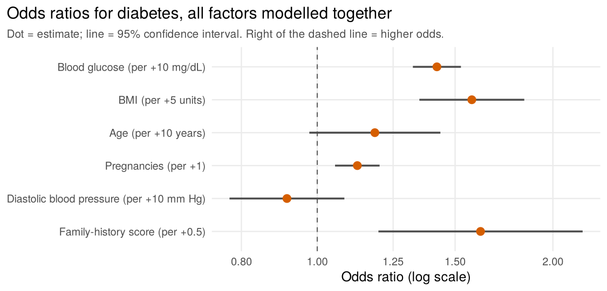

What Is Linked to Diabetes? A Plain-English Look at the Pima Indians
Diabetes Data
================
Somaan
10 October 2026

- [The short version](#the-short-version)
- [The data](#the-data)
- [Cleaning the data](#cleaning-the-data)
- [Who has diabetes?](#who-has-diabetes)
- [Which factors matter most? A
  regression](#which-factors-matter-most-a-regression)
- [How well does the model work?](#how-well-does-the-model-work)
- [Limitations](#limitations)
- [Reproducing this report](#reproducing-this-report)

## The short version

I analysed health records for 768 women from the Pima Indian community
in Arizona, 268 of whom (35%) had diabetes. The aim was to see which
measurements go along with having diabetes, and how strongly.

- **Blood glucose and body weight are the clearest signals.** After
  accounting for the other measurements, each extra 10 mg/dL of glucose
  goes with roughly 42% higher odds of diabetes, and each extra 5 BMI
  points with roughly 58% higher odds.
- **Number of pregnancies and family history also matter.** Each
  additional pregnancy and a higher family-history score are both linked
  to higher odds.
- **Age and blood pressure are not clearly linked** once everything else
  is taken into account.
- **The model separates the two groups reasonably well but is not a
  diagnostic tool.** On women it had not seen, it scored an AUC of 0.84
  (0.5 is a coin flip, 1.0 is perfect).

All of this describes *associations in one specific group*. It does not
show that changing any single factor would prevent diabetes.

## The data

The data come from a study by the US National Institute of Diabetes and
Digestive and Kidney Diseases, and are widely available from the UCI
Machine Learning Repository and Kaggle. Each row is one woman, all aged
21 or over, with eight measurements and a yes/no diabetes outcome:

| Measurement          | What it is                                                                           |
|:---------------------|:-------------------------------------------------------------------------------------|
| Pregnancies          | Number of times pregnant                                                             |
| Glucose              | Blood sugar two hours after a standard sugar drink (mg/dL)                           |
| Blood pressure       | Diastolic blood pressure (mm Hg)                                                     |
| Skin thickness       | Triceps skin-fold thickness (mm), a rough measure of body fat                        |
| Insulin              | Insulin level two hours after the sugar drink (mu U/ml)                              |
| BMI                  | Body mass index (kg/m²)                                                              |
| Family-history score | A score summarising diabetes in the woman’s relatives (higher = more family history) |
| Age                  | Age in years                                                                         |

## Cleaning the data

The raw file has no column names, so I added them from the dataset
documentation. No rows were duplicated.

The main problem is that **missing values are hidden as zeros**. A blood
pressure or BMI of 0 is impossible, so these zeros mean “not recorded”.
Left in place, they would drag averages down and distort the regression.
I converted them to missing values in the five measurements where zero
cannot be real.

| Measurement    | Zeros recoded as missing | Share of women |
|:---------------|-------------------------:|---------------:|
| Insulin        |                      374 |          48.7% |
| Skin thickness |                      227 |          29.6% |
| Blood pressure |                       35 |           4.6% |
| BMI            |                       11 |           1.4% |
| Glucose        |                        5 |           0.7% |

What I did about it:

- **Insulin and skin thickness** are missing for too many women to
  rescue (nearly half and about 30%), so I left them out of the
  regression rather than guess their values.
- For the other measurements I kept only the 724 women (94% of the data)
  with complete records. The few missing values make this a reasonable
  trade-off, but it does assume that who is missing is not
  systematically linked to diabetes.

## Who has diabetes?

| Measurement                      | No diabetes (n = 500) |  Diabetes (n = 268) |
|:---------------------------------|----------------------:|--------------------:|
| Age (years)                      |         27 (23 to 37) |       36 (28 to 44) |
| Pregnancies                      |            2 (1 to 5) |          4 (2 to 8) |
| BMI                              |   30.1 (25.6 to 35.3) | 34.3 (30.9 to 38.9) |
| Glucose (mg/dL)                  |       107 (93 to 125) |    140 (119 to 167) |
| Diastolic blood pressure (mm Hg) |         70 (62 to 78) |       74 (68 to 84) |

Median, with the middle half of values in brackets (25th to 75th
percentile). Missing values excluded.

Women with diabetes had noticeably higher glucose and BMI, and were
older and had been pregnant more times. Splitting the women into groups
makes the pattern easy to see:

<!-- -->

Only about 7% of women in the healthy-weight group had diabetes, against
roughly 46% of those with obesity. Prevalence also rises with age,
peaking at 55% among women in their 40s, and is a little lower for women
aged 50 and over. Glucose separates the two groups most clearly of all:

<!-- -->

One caution: glucose is part of how diabetes is diagnosed, so a strong
link between the two is expected and is not a surprising discovery.

## Which factors matter most? A regression

Looking at one measurement at a time can mislead, because the
measurements overlap. For example, older women have tended to be
pregnant more often (correlation about 0.56 in this data), so it is hard
to tell whether age or pregnancies is doing the work.

**Logistic regression** handles this. It estimates the link between each
measurement and diabetes *while holding the others fixed*. Results are
reported as **odds ratios**:

- An odds ratio of **1** means no link.
- Above 1 means higher odds of diabetes, and below 1 means lower odds.
- An odds ratio of 1.42 means the odds are about 42% higher.

Odds are not the same as risk. Because diabetes is common here (about
one in three), odds ratios look bigger than the change in actual
probability, which is why I also give probabilities below. I rescaled
the measurements so that each odds ratio is for a sensible step, such as
+10 mg/dL of glucose.

<!-- -->

| Factor                                   | Odds ratio | 95% confidence interval | p-value |
|:-----------------------------------------|-----------:|------------------------:|--------:|
| Blood glucose (per +10 mg/dL)            |       1.42 |            1.32 to 1.53 | \<0.001 |
| BMI (per +5 units)                       |       1.58 |            1.35 to 1.84 | \<0.001 |
| Age (per +10 years)                      |       1.18 |            0.98 to 1.44 |   0.085 |
| Pregnancies (per +1)                     |       1.13 |            1.05 to 1.20 | \<0.001 |
| Diastolic blood pressure (per +10 mm Hg) |       0.91 |            0.77 to 1.08 |   0.301 |
| Family-history score (per +0.5)          |       1.62 |            1.20 to 2.18 |   0.002 |

Logistic regression on 724 women with complete records.

**What this says in plain terms**

- **Glucose** has the strongest statistical evidence behind it: the
  chance of seeing a link this strong if there were truly none is
  vanishingly small. Each extra 10 mg/dL goes with odds about 1.42 times
  higher.
- **BMI** has a large and clear effect: each extra 5 points goes with
  odds about 1.58 times higher.
- **Pregnancies** and the **family-history score** are also clearly
  linked (odds ratios 1.13 per pregnancy and 1.62 per 0.5 on the score).
- **Age** has an odds ratio of 1.18 per decade, but its interval (0.98
  to 1.44) includes 1, so the data do not firmly separate it from no
  effect. This is partly because age and pregnancies move together.
- **Blood pressure** shows no clear link (odds ratio 0.91, interval 0.77
  to 1.08).

The steps are different sizes (10 mg/dL of glucose versus 5 BMI points
versus one pregnancy), so the odds ratios should not be read as a
ranking of which factor matters most.

**A worked example.** Take a woman with the middle value on every
measurement (glucose about 117 mg/dL, BMI about 32, age about 29). The
model puts her chance of diabetes at about **21%**. If her glucose were
20 mg/dL higher, that rises to about **35%**. If her BMI were 5 points
higher instead, it rises to about **29%**.

## How well does the model work?

A model should be tested on data it has not seen, otherwise it can look
better than it is. I split the women into five groups, trained on four,
tested on the fifth, and repeated this for each group (5-fold
cross-validation).

- **AUC 0.84.** Pick one woman with diabetes and one without at random:
  the model gives the higher score to the woman with diabetes about 84%
  of the time.
- **Accuracy 77%.** Simply guessing “no diabetes” for everyone would be
  right 66% of the time, so the model adds real information, but it
  still gets about one woman in four wrong.

That is solid for a simple model, but it is a long way from something a
clinician would rely on.

## Limitations

- **It is one specific group.** All participants are adult women of Pima
  Indian heritage in Arizona, from a study that is decades old. The
  sizes of the links may not carry over to other populations.
- **Association, not cause.** This is observational data. Higher BMI
  going with higher odds of diabetes does not prove that reducing BMI
  would lower them.
- **Glucose is part of the diagnosis**, so its strong link overstates
  how useful it is as an independent “risk factor”.
- **Missing data.** Zeros hiding missing values were a real problem. I
  dropped two measurements and incomplete records, which could introduce
  bias if the missingness is related to health.
- **Simple modelling choices.** I assumed each measurement has a
  straight-line effect on the log-odds and did not test interactions or
  fit more flexible models. The confidence intervals are the standard
  approximate (Wald) kind.
- **Unclear outcome timing.** The dataset documentation is not fully
  clear about exactly when diabetes was assessed relative to the
  measurements, so I treat the outcome as a plain yes/no flag.

## Reproducing this report

All code and data are in the project repository (see the README). Built
with R version 4.3.3 (2024-02-29), dplyr 1.1.4, ggplot2 3.4.4.
